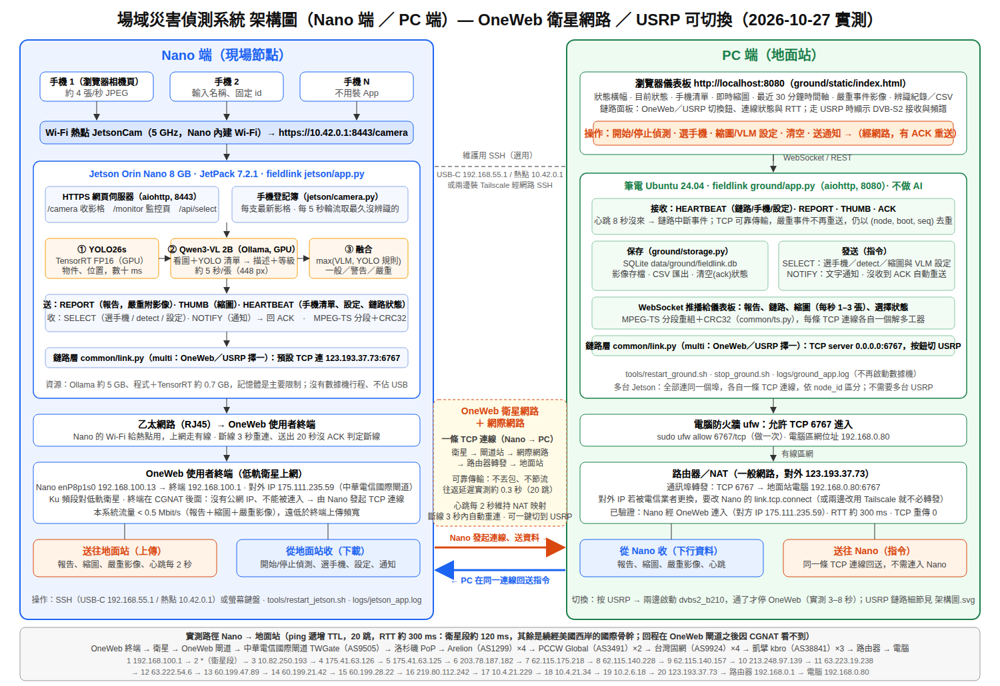
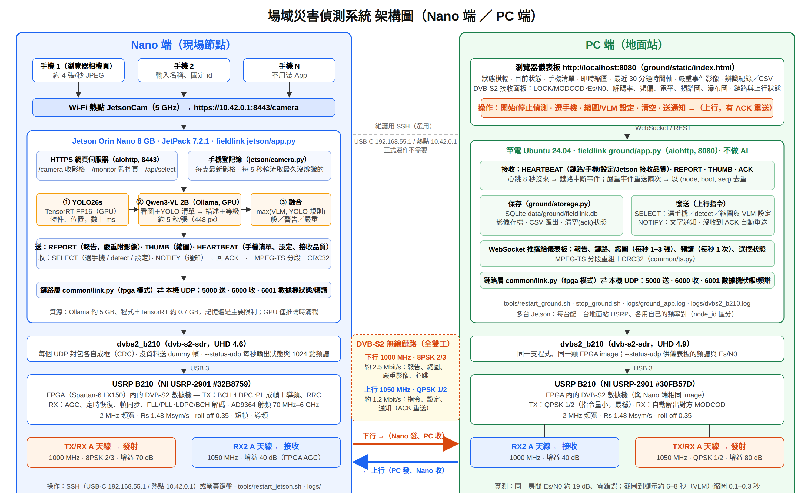
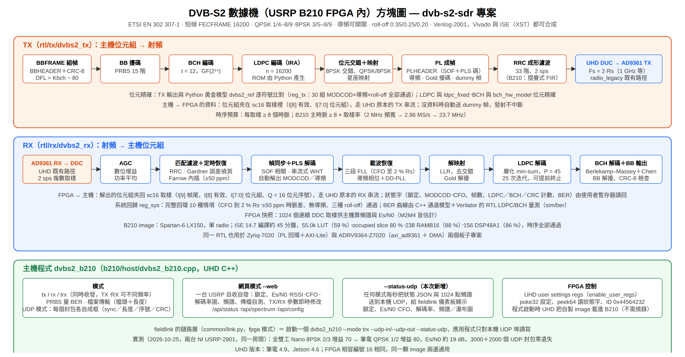

# 進度報告：場域災害偵測系統（OneWeb 衛星網路 ＋ 自建 DVB-S2 無線鏈路）

分支：`oneweb_nano`（本版，鏈路改為 OneWeb；`dvb_nano_1027` 為 DVB-S2 版）　日期：2026-10-27　報告人：lab602（Jacky）

本分支把兩個部分放在一起：

| 目錄 | 內容 |
|---|---|
| 根目錄（`rtl/`、`b210/`、`z7020/`、`adrv9364/`、`python/`、`sim/`） | **dvb-s2-sdr**：自己寫的 DVB-S2 基頻數據機（Verilog），放進 USRP B210 的 FPGA，以及 PC 端 UHD 程式 |
| `fieldlink/` | **場域災害偵測應用**：手機當攝影機 → Jetson Orin Nano 做 YOLO＋VLM 判讀 → 回傳地面站儀表板。**2026-10-27 下午起預設鏈路改為 OneWeb 衛星上網（`link.mode: tcp`，Nano 主動 TCP 連到地面站），DVB-S2 鏈路保留為備用（`link.mode: fpga`）**；實測 OneWeb RTT 約 300 ms、指令來回 0.4 秒。詳見 `fieldlink/README.md` 與 `fieldlink/docs/架構圖_oneweb.svg` |
| `docs/`、`fieldlink/docs/` | 架構圖（SVG／PNG） |
| `fieldlink/操作手冊.md`、`fieldlink/系統簡介.md`、`fieldlink/進度紀錄.md` | 操作手冊、簡介、逐日進度 |

---

## 1. 目標與成果摘要

**目標**：在沒有網際網路、基地台的現場，用自己實作的 DVB-S2 數據機建立一條點對點無線鏈路，把現場 AI 判讀的災害狀況（火、煙、淹水、人員異常）即時傳回地面站，地面站也能反向控制現場。

**截至 2026-10-27 的成果**：

1. DVB-S2 數據機（TX＋RX）以 Verilog 實作並通過與 Python 模型的位元精確比對，編譯進 USRP B210 的 Spartan-6 FPGA（ISE 14.7，時序全部通過），在兩台 NI USRP-2901 上完成**全雙工空中傳輸**：下行 8PSK 2/3、上行 QPSK 1/2，Es/N0 約 19 dB，數千個 UDP 封包零遺失。
2. 現場節點（Jetson Orin Nano 8 GB，JetPack 7.2.1）：多支手機經 Wi-Fi 熱點上傳畫面，YOLO26s（TensorRT）＋Qwen3-VL 2B（Ollama）融合判讀為三級狀態，每 5 秒輪流處理一支手機；嚴重事件附畫框影像。
3. 地面站儀表板：狀態橫幅、手機清單與即時縮圖、最近 30 分鐘時間軸、嚴重事件影像、辨識紀錄與 CSV、**DVB-S2 接收面板**（鎖定、Es/N0、頻偏、解碼率、頻譜、瀑布圖）、上行狀態；可開始／停止偵測、選手機、調整縮圖與 VLM 解析度、清空統計、送通知到現場。
4. 真機實測：手機拍火災畫面 → Jetson 判「嚴重」→ 影像與描述經無線鏈路顯示在地面站，截圖到顯示約 6–8 秒。

---

## 2. 系統架構

### 2.1 整體架構（現場 Nano 端 / 地面站 PC 端）— 正式：OneWeb 衛星網路（2026-10-27 下午起）



（原檔 `fieldlink/docs/架構圖_oneweb.svg`；圖底是實測的 20 跳路徑）

```
手機 ×N ──Wi-Fi 熱點 JetsonCam──▶ Jetson Orin Nano ──RJ45──▶ OneWeb 使用者終端 ~~ 低軌衛星 ~~ 閘道站 → 網際網路 → 路由器（TCP 6767 轉發）──▶ 地面站電腦
  瀏覽器相機頁，不裝 App            YOLO + VLM 判讀            一條 TCP 連線，由 Nano 主動連到 123.193.37.73:6767（OneWeb 終端在 CGNAT 後面不能被連入）   儀表板 / SQLite / CSV
                                                              Nano → 地面站：報告、縮圖、嚴重影像、心跳　　地面站 → Nano（同一連線回送）：開始/停止偵測、選手機、設定、通知
```

| 層 | Nano 端 | PC 端 |
|---|---|---|
| 應用 | 同下表（不變） | 同下表（不變） |
| 訊息 | MPEG-TS 分段＋CRC32 直接寫入 TCP 位元流 | 每條 TCP 連線各一個解多工器（可同時接多台 Nano） |
| 鏈路 | `fieldlink/common/link.py` **tcp 模式**（client）：連 `123.193.37.73:6767`，TCP keepalive ＋ `TCP_USER_TIMEOUT` 20 s，斷線 3 秒重連；TCP 可靠，不重送、不節流 | tcp 模式（server）：監聽 `0.0.0.0:6767`；儀表板「資料鏈路」面板顯示連線、RTT、重傳、收送量、重連（Linux `TCP_INFO`） |
| 網路 | enP8p1s0 192.168.100.13 → OneWeb 終端 192.168.100.1；對外 IP 175.111.235.59（AS9505 中華電信國際閘道） | 電腦 192.168.0.80 ← 路由器 192.168.0.1（對外 123.193.37.73，kbro）轉發 TCP 6767；`ufw allow 6767/tcp` |
| 實測 | RTT 約 300 ms、TCP 重傳 0、SELECT 來回 0.4 秒；路徑 20 跳：衛星段約 120 ms，之後經中華電信國際閘道 → 洛杉磯 → Arelion → PCCW Global → 台灣固網 → 凱擘，繞美西再回台灣 | 同左（地面站端 `ss -tni` 看到對方 175.111.235.59，rtt 295 ms） |

DVB-S2 無線鏈路保留為**備用**：兩邊 `link.mode` 改 `fpga` 即切回，不需要網路。以下是 DVB-S2 版架構：



（原檔 `fieldlink/docs/架構圖.svg`）

```
手機 ×N ──Wi-Fi 熱點 JetsonCam──▶ Jetson Orin Nano ──USB 3──▶ USRP B210 ~~ DVB-S2 ~~ USRP B210 ◀──USB 3── 地面站電腦
  瀏覽器相機頁，不裝 App            YOLO + VLM 判讀                下行 1000 MHz 8PSK 2/3：報告、縮圖、嚴重影像、心跳    儀表板 / SQLite / CSV
                                                                 上行 1050 MHz QPSK 1/2：開始/停止偵測、選手機、設定、通知
```

| 層 | Nano 端 | PC 端 |
|---|---|---|
| 應用 | `fieldlink/jetson/app.py`：HTTPS 相機頁與監控頁、手機登記簿、輪流辨識、訊息（REPORT／THUMB／HEARTBEAT，回 ACK） | `fieldlink/ground/app.py`：接收、去重、SQLite／影像／CSV、上行指令重送、WebSocket 推播儀表板 |
| 訊息 | MPEG-TS 分段＋CRC32（`fieldlink/common/ts.py`）、應用層 JSON（`protocol.py`） | 同左 |
| 鏈路 | `fieldlink/common/link.py` fpga 模式：啟動 `dvbs2_b210`，本機 UDP 5000/6000 傳資料、6001 收狀態與頻譜 | 同左 |
| 數據機主機程式 | `b210/host/dvbs2_b210`（UHD 4.6）：UDP 封包成框、dummy 幀、`--status-udp` | 同左（UHD 4.9） |
| FPGA | USRP B210 內的 DVB-S2 數據機（本專案 RTL） | 同一顆 image |
| 射頻 | TX/RX A 發 1000 MHz（增益 70）、RX2 A 收 1050 MHz | TX/RX A 發 1050 MHz（增益 80）、RX2 A 收 1000 MHz |

### 2.2 DVB-S2 數據機（FPGA 內）方塊圖



（原檔 `docs/dvbs2_modem_架構圖.svg`）

---

## 3. 技術說明

### 3.1 DVB-S2 基頻數據機（`rtl/`）

- **規格**：ETSI EN 302 307-1，短幀 FECFRAME（16200 位元），QPSK 1/4–8/9 與 8PSK 3/5–8/9，導頻可開關，roll-off 0.35／0.25／0.20，dummy 幀。Verilog-2001，Vivado 與 ISE（XST）都能合成，同一套 RTL 用在三個板子專案（Zynq-7020 回環、USRP B210、ADRV9364 SOM）。
- **TX 鏈**：BBHEADER＋CRC-8 → BB 擾碼 → BCH（t = 12）→ LDPC（IRA 累加結構，奇偶表由 Python 產生成 ROM）→ 8PSK 位元交錯 → 星座映射 → PLHEADER（SOF＋PLS 碼，π/2-BPSK）＋導頻＋Gold 擾碼 → RRC 33 階成形濾波（2 sps）。B210 版使用摺疊式 FIR（每側 3 個乘法器）以符合 Spartan-6 的 DSP 數量。
- **RX 鏈**：AGC → RRC 匹配濾波 → Gardner 定時誤差偵測＋Farrow 內插（可追 ±50 ppm 取樣率差）→ 差分 SOF／PLS 相關器（抗頻偏）→ PLS 解碼（串流式 Walsh–Hadamard，自動解出 MODCOD 與導頻設定）→ 三段 FLL（追到 2 % Rs 的頻偏）＋導頻相位內插／判決導向 PLL → 軟解映射（LLR）→ 層化 normalized min-sum LDPC（45 路平行、雙緩衝、提前終止，25 次迭代內跟得上 16 clk/符號）→ BCH（Berlekamp–Massey＋Chien）→ BB 解擾與 CRC 檢查。
- **驗證方法**：TX 輸出與 Python 黃金模型 `dvbs2_ref` 逐樣本比對（30 組 MODCOD×導頻×roll-off 全過）；LDPC 與 `ldpc_fixed`、BCH 與 `bch_hw_model` 位元精確；系統回歸 `reg_sys full` 10 種情境（CFO 到 2 % Rs、±50 ppm、無導頻、各 roll-off）通過；BER 曲線由 C++ 通道模型＋Verilator 編譯的 RTL 解碼器量測（`sim/ber/ber_curves.png`）。
- **時序預算**：每取樣 ≥ 8 時脈；B210 主時脈 ≥ 8 × 取樣率（2 MHz 頻寬 → 2.96 MS/s → 23.7 MHz 主時脈）。

### 3.2 放進 USRP B210（`b210/`）

- `patch_uhd_fpga.py` 把 RTL 插進 UHD 的 `radio_legacy`（主機串流與 DUC/DDC 之間），新增 make 目標 `B210_DVBS2`；image 為單 radio（移除 radio 1 騰出空間）。
- 主機 ↔ FPGA：UHD user settings 暫存器（設定、狀態字、ID `0x44564232`）；酬載位元組夾在 sc16 取樣裡（TX `I[8]` 有效＋`I[7:0]` 位元組；RX `I[9]` 幀尾、`I[8]` 有效、`Q` 序號），不需要改 UHD 驅動。
- **ISE 14.7 編譯結果**（UHD 4.9.0.0 原始碼，2026-10-22）：55.0k LUT（59 %）、occupied slice 80 %、238 RAMB16（88 %）、156 DSP48A1（86 %），時序全部通過，約 45 分鐘。授權：AMD 對註冊用戶免費提供的 ISE Embedded Edition（WebPACK 不含 LX150）。
- PC 程式 `dvbs2_b210`：tx／rx／trx 模式、PRBS 量 BER、檔案傳輸、UDP 模式（每個封包各自成框：sync、長度、序號、CRC-16／CRC-32）、網頁模式（自收自發、頻譜、Es/N0 盲估計）；本次新增 `--status-udp`，每秒把狀態與 1024 點頻譜 JSON 送到本機 UDP 供儀表板使用。

### 3.3 現場節點（`fieldlink/jetson/`）

- 手機經熱點用瀏覽器開 HTTPS 相機頁（自簽憑證），WebSocket 傳 JPEG，每支手機有固定 id 與名稱；登記簿保存每支最新影格，每 5 秒取「最久沒辨識且有新影格」的一支。
- YOLO26s（Ultralytics → TensorRT FP16，每張數十 ms）先偵測；Qwen3-VL 2B（Ollama，GPU）看圖＋YOLO 清單，依設定檔中的三級準則輸出中文描述與等級（448 px 約 5 秒）；最終等級取兩者較嚴重者，寧可多報。
- 下行訊息：REPORT（報告，嚴重時附畫了偵測框的影像，每類別固定顏色）、THUMB（被選手機縮圖，可丟棄的低優先權）、HEARTBEAT（手機清單、目前設定、自己的接收品質）。上行：SELECT（選手機／detect／縮圖與 VLM 設定）、NOTIFY（文字通知），都回 ACK，地面站沒收到會重送。
- 執行期可調：是否辨識（detect）、縮圖頻率與大小、VLM 影像解析度，預設偏低以保護 8 GB 記憶體。

### 3.4 地面站（`fieldlink/ground/`）

- aiohttp 服務：接收並以 (node, boot, seq) 去重、SQLite 保存（報告、通知、鏈路事件、kv）、影像存檔、CSV 匯出；WebSocket 每秒推播鏈路狀態、縮圖、頻譜。
- 儀表板（深色地面站風格）：狀態橫幅（開始／停止偵測、看影像、清空、送通知）、目前狀態、手機面板、即時縮圖、DVB-S2 接收面板（LOCK／MODCOD／導頻／FLL、Es/N0、解碼率、頻偏、電平、計數、頻譜與瀑布圖）、鏈路與上行、30 分鐘時間軸、嚴重事件影像、通知、辨識紀錄。
- 「清空」把目前為止的報告從儀表板移除並歸零 30 分鐘統計（存 DB，重啟記得）；紀錄表不刪。

### 3.5 鏈路參數與實測

**OneWeb 衛星網路（正式，`link.mode: tcp`）**

| 項目 | 值 |
|---|---|
| 連線 | 一條 TCP，Nano（OneWeb 終端 LAN 192.168.100.13）→ 地面站對外 `123.193.37.73:6767`（路由器轉發到 192.168.0.80） |
| 往返延遲 | 約 300 ms（`TCP_INFO` 兩端各量：295／330 ms；ping 平均 265 ms） |
| 路徑 | 20 跳：終端 → 衛星 → OneWeb 閘道 10.82.250.193（約 120 ms）→ TWGate 175.41.63.x → 洛杉磯 203.78.187.182（跳到約 260 ms）→ Arelion ×4 → PCCW ×2 → 台灣固網 ×4 → 凱擘 ×3 → 123.193.37.73 |
| 品質 | TCP 重傳 0、1 分鐘內無重連；地面站重啟後 Nano 8 秒內自動重連 |
| 指令來回 | SELECT 送出到收到 ACK 0.4 秒；截圖到儀表板 6–8 秒（VLM 為主）；縮圖 0.4–0.7 秒 |
| 用量 | 心跳每 2 秒約 1 kB、縮圖每秒 1 張約 8 kB、嚴重影像 ≤ 60 kB；合計 < 0.1 Mbit/s |
| 斷線處理 | TCP keepalive 10 s／5 s×3 ＋ `TCP_USER_TIMEOUT` 20 s；重連 3 秒、重試 5 秒；指令／通知應用層 ACK 重送 |

**DVB-S2 無線鏈路（備用，`link.mode: fpga`）**

| 項目 | 值 |
|---|---|
| 頻寬／符號率 | 2 MHz／1.48 Msym/s，roll-off 0.35，短幀，導頻 |
| 下行（Nano → 地面站） | 1000 MHz，8PSK 2/3，約 2.5 Mbit/s，TX 增益 70 dB |
| 上行（地面站 → Nano） | 1050 MHz，QPSK 1/2，約 1.2 Mbit/s，TX 增益 80 dB |
| RX 增益 | 40 dB（FPGA 內 AGC） |
| 同一房間實測 | Es/N0 約 19 dB，兩台自由振盪頻偏約 ±2 kHz 自動追鎖，零位元錯誤 |
| 全雙工 UDP 測試 | 同時 3000（下行）＋2000（上行）個 20–1400 B 封包，0 遺失、0 損壞，LDPC 1–2 次迭代 |
| 延遲 | 截圖到地面站顯示約 6–8 秒（VLM 推論為主）；縮圖約 0.1–0.3 秒 |

---

## 4. 進度紀錄（依日期）

| 日期 | 完成事項 |
|---|---|
| 2026-10-22 | 筆電裝好 UHD 4.9、ISE 14.7 與免費 Embedded Edition 授權；用 UHD 4.9 原始碼重編 B210 DVB-S2 image（時序通過）；USRP 載入後數據機偵測成功；單機自收自發 8PSK 2/3：Es/N0 16.4 dB、1.3 億位元 0 錯誤 |
| 2026-10-22 | Jetson Orin Nano 以 SDK Manager 重刷 JetPack 7.2.1 與全部 SDK 元件 |
| 2026-10-25 | Nano 裝 UHD、編 `dvbs2_b210`、載入 image；兩台對傳：TX 增益 40 收不到、70 才夠；單向 UDP 3000 封包零遺失；全雙工：上行方向餘裕不足改 QPSK 1/2＋增益 80 後兩方向同時零遺失 |
| 2026-10-25 | fieldlink 整合：新增 fpga 鏈路模式、多手機輪流辨識、SELECT／THUMB、node_id、儀表板手機面板與縮圖；本機 udp 模式端對端測試通過；實機射頻端對端通過（真機＋假手機） |
| 2026-10-25 | 修 VLM 空輸出（Ollama 的 qwen3-vl:2b 為 thinking 版，改用預填空 think 區塊）；縮圖／VLM 參數可從儀表板調整並降低預設；嚴重事件影像依類別配色 |
| 2026-10-25 | `dvbs2_b210 --status-udp`；儀表板改地面站風格並新增 DVB-S2 接收面板（頻譜、瀑布圖）、上行狀態；「清空」、「開始／停止偵測」；VLM JSON 解析強化；熱點 JetsonCam；真手機拍火災畫面實測判「嚴重」 |
| 2026-10-27 | 操作手冊（含無 USB-C 時的操作與自動啟動）、系統簡介、架構圖；本分支整理 |
| 2026-10-27 下午 | **鏈路改為 OneWeb 衛星網路**：Nano 接 OneWeb 終端、電腦接一般網路；`common/link.py` 新增 tcp 模式（Nano client → 地面站 server，TS 位元流直接走 TCP，每條連線各自解多工，keepalive＋`TCP_USER_TIMEOUT`）；儀表板 DVB-S2 面板在 tcp 模式變成「資料鏈路：OneWeb」；筆電假手機＋假 Ollama 經 127.0.0.1 與公網位址驗證，再真 Nano 經 OneWeb 連上（RTT 約 300 ms、重傳 0）；ping 遞增 TTL 量出 20 跳路徑；修正手機相機頁預覽被開始頁遮住、VLM 開機暖機 timeout；文件與架構圖改版；分支 `oneweb_nano` |

---

## 5. 遇到的問題與解法

| 問題 | 原因 | 解法 |
|---|---|---|
| 兩台 USRP 之間收不到 | 單機自收自發天線只隔幾公分，增益 40 dB 夠；兩台相距數公尺不夠 | 兩台之間 TX 增益 70／80 dB；儀表板顯示電平，飽和時再降 |
| 全雙工時上行解不出 | 上行方向 Es/N0 只有 9 dB，自己的 TX 又吃掉約 2 dB，8PSK 2/3 門檻約 7 dB | 上行改 QPSK 1/2（門檻約 1 dB），增益 80 |
| VLM 全部回「無法解析」 | Ollama 的 qwen3-vl:2b 是 thinking 版，`think:false`、`/no_think` 實測都擋不住思考，token 用完 content 為空 | assistant 預填空的 `<think></think>` 區塊，三張不同影像全部正確；另修正模型把 JSON 寫兩次的解析問題 |
| Nano 記憶體耗盡、Ollama 被 OOM 砍 | 模型約 5 GB＋程式＋桌面，另有測試同時發請求 | `OLLAMA_NUM_PARALLEL=1`、`num_ctx` 3072、VLM 影像 448 px、縮圖預設 1 張/秒；建議關桌面 |
| Nano 端數據機 USB 欠載 | AI 推論時 `dvbs2_b210` 搶不到即時排程 | 加大 UHD USB 緩衝；待辦：把使用者加入 usrp 群組取得 rtprio |
| 兩台振盪器頻偏 ±2 kHz | 自由振盪 | RX 三段 FLL 自動追鎖，不需外部參考時脈 |

---

## 6. 目前限制與下一步

- **記憶體**：Orin Nano 8 GB 在 VLM＋YOLO＋桌面下可用約 1 GB；待辦：關桌面、usrp 群組（已寫在操作手冊 §3.7）。
- **網路鏈路**：地面站對外 IP 由電信業者配發，變了 Nano 就連不上（要改 `link.tcp.connect`，或兩邊改用 Tailscale）；OneWeb 落地與家用寬頻之間繞美西，RTT 約 300 ms（指令來回 0.4 秒，可接受）。
- **多現場節點**：tcp 模式鏈路層已可同時接多台 Nano（各自解多工），但儀表板即時狀態仍只顯示單一節點；DVB-S2 備用鏈路則一台地面站 USRP 一次只收一個頻道。
- **模型**：預設 COCO YOLO 沒有火／煙類別，目前靠 VLM 判斷；下一步收集場域影像訓練專用 YOLO，設定 `fusion.rules` 讓偵測到火／煙直接升級嚴重。
- **距離**（DVB-S2 備用鏈路）：目前只在同一房間驗證（餘裕約 12 dB）；下一步戶外距離測試、高增益天線或提高符號率。
- **法規**：1000／1050 MHz 僅為實驗頻率，正式空中傳輸須符合 NCC 規範。

---

## 7. 如何執行（摘要，詳見 `fieldlink/操作手冊.md`）

```bash
# 地面站電腦
cd fieldlink && python3 -m venv .venv && .venv/bin/pip install aiohttp pyyaml pillow
./tools/restart_ground.sh                 # 儀表板 http://localhost:8080（需要 b210/host/build/dvbs2_b210 與 b210/out/usrp_b210_dvbs2_fpga.bin）

# Jetson（熱點 JetsonCam 已設定）
ssh lab602@192.168.55.1 '~/fieldlink/tools/restart_jetson.sh'

# 手機：連 JetsonCam，開 https://10.42.0.1:8443/camera，輸入名稱 → 儀表板按「開始偵測」
```

FPGA image 的編譯（ISE 14.7，約 45 分鐘）與 PC 程式的編譯見 `b210/README.md`；數據機的模擬回歸見根目錄 `README.md`。
